# DP-Hogar · App móvil

App para pacientes de diálisis peritoneal en casa y sus cuidadores (React Native + Expo, iOS y Android).

> **Estado:** proyecto base (BASE-MOV) + acceso completo: **login por credenciales (MOV-RF-003)**, **activación por invitación (MOV-RF-001)**, **consentimiento informado (MOV-RF-002)** y **generador de pacientes sintéticos (SIS-RF-019)**. El backend todavía no tiene esos endpoints: la app usa un **backend simulado** detrás de interfaces (ver [Backend simulado](#backend-simulado-y-endpoints-pendientes)).

| Login                                        | Inicio                                   | Registrar                                      | Signos vitales                                           | Alertas                                    |
| -------------------------------------------- | ---------------------------------------- | ---------------------------------------------- | -------------------------------------------------------- | ------------------------------------------ |
| 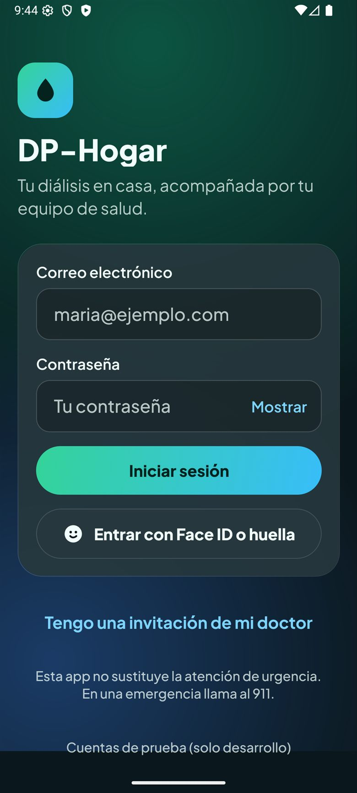 | 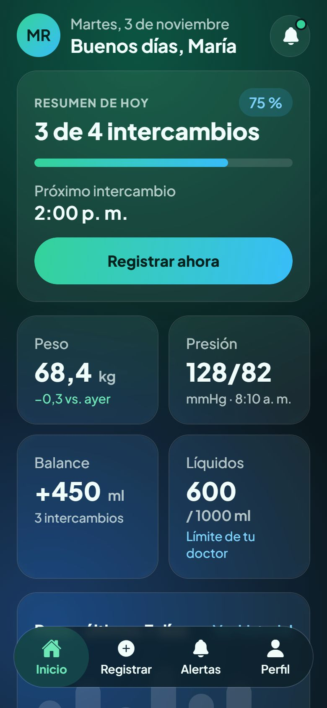 | 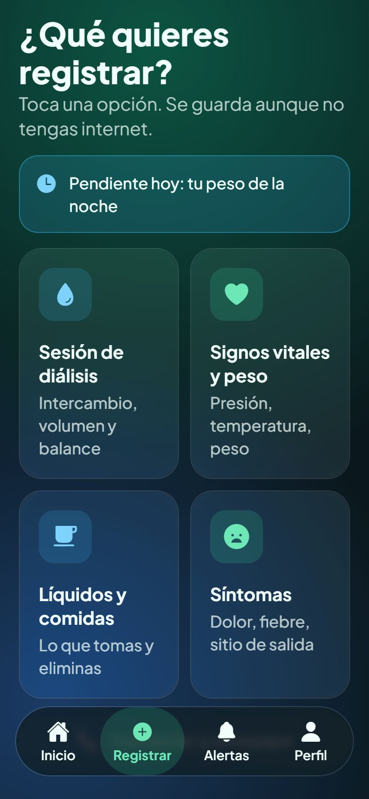 | 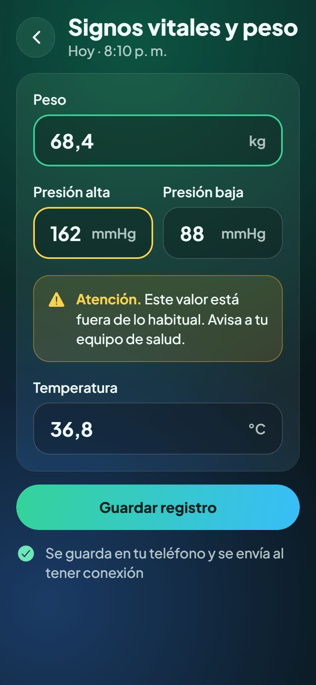 | 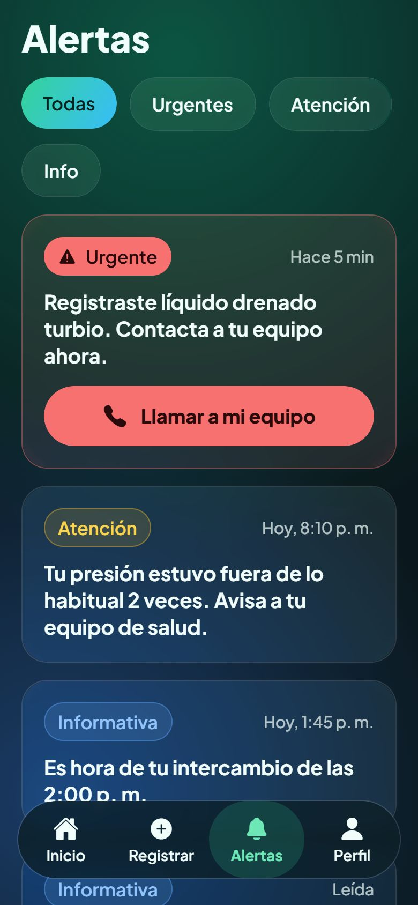 |

## Requisitos

- [Node.js](https://nodejs.org/) 20 o más reciente (probado con Node 24) y npm.
- Para probar en un teléfono: la app **Expo Go** (iOS o Android), versión para **SDK 58**.
- Para emuladores (opcional):
    - **Android:** Android Studio con un emulador (AVD).
    - **iOS:** una Mac con Xcode y el simulador de iOS.

No necesitas Python ni Docker para trabajar solo en la app móvil.

## Cómo correr la app

```bash
cd mobile
npm install
cp .env.example .env.local   # opcional: todavía no se usa
npm start                    # abre Expo; escanea el QR con Expo Go
```

| Plataforma         | Comando           | Notas                                                                    |
| ------------------ | ----------------- | ------------------------------------------------------------------------ |
| Android (emulador) | `npm run android` | Abre el emulador y lo instala en Expo Go.                                |
| iOS (simulador)    | `npm run ios`     | Solo en Mac.                                                             |
| Teléfono físico    | `npm start`       | Escanea el QR. El teléfono y la computadora deben estar en la misma red. |
| Navegador          | `npm run web`     | Útil para revisar el diseño rápido; la app está pensada para móvil.      |

Para entrar usa **`maria@ejemplo.com` / `demo1234`** (o cualquier paciente de [Cuentas de prueba](#pacientes-sintéticos-sis-rf-019)). La primera vez en cada teléfono te pedirá aceptar el consentimiento.

> Expo Go basta para todo (SecureStore y huella vienen incluidos). Face ID en iOS necesita una build de desarrollo (`npx expo run:ios`).

### Variables de entorno

| Variable                      | Para qué                                                | Valor de ejemplo                                                                    |
| ----------------------------- | ------------------------------------------------------- | ----------------------------------------------------------------------------------- |
| `EXPO_PUBLIC_API_URL`         | URL del backend (todavía no se usa)                     | `http://localhost:8000` (simulador iOS) · `http://10.0.2.2:8000` (emulador Android) |
| `EXPO_PUBLIC_SYNTHETIC_SEED`  | Semilla de los pacientes sintéticos (solo desarrollo)   | `2026`                                                                              |
| `EXPO_PUBLIC_SYNTHETIC_COUNT` | Cuántos pacientes sintéticos, incluida María (máx. 200) | `8`                                                                                 |

`.env.local` es personal y no se sube a Git.

## Scripts

| Script                            | Qué hace                                                        |
| --------------------------------- | --------------------------------------------------------------- |
| `npm start`                       | Servidor de desarrollo de Expo                                  |
| `npm run android` / `ios` / `web` | Abre la app en esa plataforma                                   |
| `npm run typecheck`               | TypeScript estricto (`tsc --noEmit`)                            |
| `npm run lint`                    | ESLint (configuración de Expo + Prettier)                       |
| `npm run format` / `format:check` | Formatea / revisa el formato con Prettier                       |
| `npm test`                        | Pruebas con Jest y React Native Testing Library                 |
| `npm run doctor`                  | `expo-doctor`: revisa dependencias y configuración              |
| `npm run export`                  | Genera los bundles de producción (comprueba que la app compila) |
| `npm run synthetic`               | Imprime pacientes sintéticos en JSON (ver SIS-RF-019)           |

Antes de abrir un PR: `npm run typecheck && npm run lint && npm test && npm run doctor`.

## Estructura

```
mobile/
├── index.ts                 # punto de entrada (registra src/App)
├── app.json                 # configuración de Expo
├── src/
│   ├── App.tsx              # fuentes, proveedores y navegación
│   ├── navigation/          # RootNavigator, AuthStack, MainTabs, pilas y tipos de rutas
│   ├── screens/             # una carpeta por módulo (auth, home, register, alerts, profile, dev)
│   ├── components/ui/       # componentes base del sistema de diseño (+ __tests__)
│   ├── theme/               # tokens: colores, tipografía, espaciado, vidrio
│   ├── services/            # contratos (auth, invitaciones, consentimiento, pacientes), backend
│   │                        #   simulado, almacenamiento seguro, biometría y sesión
│   ├── constants/           # textos compartidos, módulos y datos ficticios
│   ├── types/               # tipos compartidos
│   ├── utils/               # formato, rangos de ejemplo, contraste y validación de formularios
│   ├── dev/synthetic/       # SOLO DESARROLLO: generador de pacientes sintéticos (SIS-RF-019)
│   └── test-utils/          # renderApp y servicios en memoria para las pruebas
├── scripts/                 # generate-synthetic.ts (npm run synthetic)
└── docs/screenshots/        # capturas para el README y los PR
```

## Navegación

```
RootNavigator ── abriendo ─────> "Abriendo DP-Hogar…" (lee el token guardado)
              ├─ sin sesión ───> AuthStack: Login (MOV-RF-003)
              │                    → Código de invitación → Datos y contraseña (MOV-RF-001)
              │                    → Cuentas de prueba (solo __DEV__)
              ├─ sin consentimiento ─> ConsentStack: Consentimiento (MOV-RF-002), sin salida a la app
              └─ con sesión y consentimiento ─> MainTabs (barra flotante)
                                 ├─ Inicio (M7)
                                 ├─ Registrar ─ menú → Sesión de diálisis (M2) · Signos vitales y peso (M3)
                                 │                     · Líquidos y comidas (M4) · Síntomas (M6)
                                 ├─ Alertas (M8)
                                 └─ Perfil (M1/M12) → Contactos y emergencia (M9) · Ajustes (M12)
                                                    · Catálogo de componentes (solo __DEV__)
```

- Las rutas están tipadas en `src/navigation/types.ts`.
- La barra de pestañas se oculta dentro de los formularios (por ejemplo, Signos vitales).
- Las pantallas sin diseño muestran título, código del módulo y "En construcción".

## Sistema de diseño: "glass oscuro"

Fondo azul petróleo con brillos ambientales, tarjetas de vidrio translúcido y acento verde → azul. Está adaptado a personas mayores: la legibilidad va primero. Los tokens viven en `src/theme/`; **no escribas colores, tamaños ni fuentes a mano en las pantallas**.

### Colores (`theme/colors.ts`)

| Token                                   | Valor                                                               | Uso                                                               |
| --------------------------------------- | ------------------------------------------------------------------- | ----------------------------------------------------------------- |
| `bg`                                    | `#0A171C`                                                           | Fondo base                                                        |
| `glowPrimary` / `glowSecondary`         | `rgba(16,185,129,0.38)` / `rgba(59,130,246,0.34)`                   | Brillos radiales (verde arriba, azul abajo)                       |
| `glass` · `glassBorder` · `glassSubtle` | `rgba(255,255,255,0.08)` · `0.14` · `0.05`                          | Tarjetas de vidrio, bordes, tarjetas leídas                       |
| `tabBarBg`                              | `rgba(15,32,38,0.82)`                                               | Barra de pestañas                                                 |
| `inputBg` · `inputBorder`               | `rgba(0,0,0,0.25)` · `rgba(255,255,255,0.18)`                       | Campos de texto                                                   |
| `text` · `textMuted`                    | `#F0FDFA` · `rgba(240,253,250,0.72)`                                | Texto principal y secundario                                      |
| `accentGradient`                        | `#34D399 → #38BDF8` (135°)                                          | Botón primario, chip activo, progreso, avatar, logo, barra de hoy |
| `onAccent`                              | `#04231F`                                                           | Texto sobre el degradado                                          |
| `accentGreen` · `accentGreenSoft`       | `#6EE7B7` · `rgba(52,211,153,0.18)`                                 | Pestaña activa (`accentText` / `accentSoft`)                      |
| `accentBlue` · `accentBlueSoft`         | `#7DD3FC` · `rgba(56,189,248,0.16)`                                 | Enlaces, badges, pendientes, notas del doctor                     |
| `focusBorder`                           | `#34D399`                                                           | Borde de campo enfocado                                           |
| `success`                               | `#6EE7B7`                                                           | Cambios positivos, guardado sin conexión                          |
| `info`                                  | `#93C5FD` sobre `rgba(96,165,250,0.18)`                             | Severidad informativa                                             |
| `attention`                             | `#FCD34D` sobre `rgba(251,191,36,0.14)`, borde `0.40`               | Atención / valor fuera de rango                                   |
| `urgent` · `onUrgent`                   | `#F87171` · `#2A0A0A`, fondo `rgba(248,113,113,0.12)`, borde `0.45` | Urgente, botón de peligro                                         |
| `urgentTextSoft`                        | `#FECACA`                                                           | Texto del botón `dangerSoft`                                      |

Una prueba automática (`theme/contrast.test.ts`) comprueba que los pares texto/fondo cumplen **4.5:1**.

### Tipografía (`theme/typography.ts`)

Plus Jakarta Sans (400–800). Una familia por peso, porque Android ignora `fontWeight` con fuentes propias.

| Variante                    | Tamaño / alto de línea         | Peso      |
| --------------------------- | ------------------------------ | --------- |
| `display`                   | 34 / 40                        | 800       |
| `title`                     | 28 / 34                        | 800       |
| `heading`                   | 22 / 28                        | 700       |
| `stat` · `statUnit`         | 30 / 36 · 17 / 22              | 800 · 600 |
| `bodyLg` · `lead`           | 19 / 25 · 19 / 26              | 700 · 400 |
| `body` · `label`            | 17 / 24 · 17 / 22              | 500 · 600 |
| `button`                    | 18 / 24                        | 800       |
| `caption` · `overline`      | 15 / 20 · 14 / 18 (mayúsculas) | 500 · 700 |
| `inputText` · `inputNumber` | 20 / 26 · 24 / 30              | 500 · 700 |
| `tabLabel`                  | 14 / 18                        | 600       |

### Espaciado, radios y tamaños (`theme/layout.ts`)

- Espaciado: 4 · 8 · 12 · 16 · 20 · 24 · 32. Margen lateral de pantalla: 20.
- Radios: 12 · 16 · 20 · tarjeta 24 · píldora.
- Área táctil mínima 48; botón 56; campo 64; ícono 24 (30 dentro de cuadros de 56 en el menú).
- Barra flotante: 72 de alto, a 16 de los lados y 24 del fondo (más la zona segura).

### Vidrio (`theme/glass.ts`)

`GlassCard` usa `BlurView` de expo-blur (intensidad 24, tinte oscuro) en iOS y web. En **Android** usa por defecto un fondo sólido translúcido (`androidFallback`), porque el desenfoque real necesita un `BlurTargetView` y puede ir lento. Cambia `glass.androidMode` a `'blur'` para probarlo.

### Íconos

Los SVG del prototipo están en `components/ui/glyphs.tsx` (react-native-svg) y se usan con el prefijo `dp-`: `dp-drop` (logo), `dp-face`, `dp-check`, `dp-tick`, `dp-warn`, `dp-clock`, `dp-back`, `dp-user`, `dp-phone`. El resto son Ionicons **rellenos** (`@expo/vector-icons`): `home`, `add-circle`, `notifications`, `person`, `water`, `heart`, `cafe`, `sad`, `call`, `warning`, `checkmark-circle`, `time`. Siempre van con texto al lado y se ocultan al lector de pantalla; solo `IconButton` va sin texto, y exige `accessibilityLabel`.

### Componentes (`components/ui`)

`Screen`, `AmbientBackground`, `GlassCard`, `AppText`, `Button` (primary, secondary, danger, dangerSoft; con carga, deshabilitado e ícono), `IconButton`, `StatCard`, `ProgressBar`, `MenuTile`, `TextField` (con `error`, `helperText` y accesorio), `PasswordField` (Mostrar/Ocultar), `RequirementList`, `Checkbox`, `Toast` (`useToast`), `NumberField`, `InlineNotice` (info, attention, urgent, pending), `SeverityBadge`, `FilterChips`, `AlertCard`, `FloatingTabBar`, `EmptyState`, `LoadingView`, `ConfirmDialog`, `OfflineHint`, y los auxiliares `Avatar`, `AppLogo`, `ScreenHeader`, `ListItem`, `Grid` y `AccentGradient`.

En desarrollo, **Perfil → Catálogo de componentes** muestra todos los componentes con sus variantes.

## Acceso: login, invitación y consentimiento

| Login                                        | Validación                                                   | Credenciales incorrectas                                              | Consentimiento                                                 | Aceptar                                                         |
| -------------------------------------------- | ------------------------------------------------------------ | --------------------------------------------------------------------- | -------------------------------------------------------------- | --------------------------------------------------------------- |
|  | 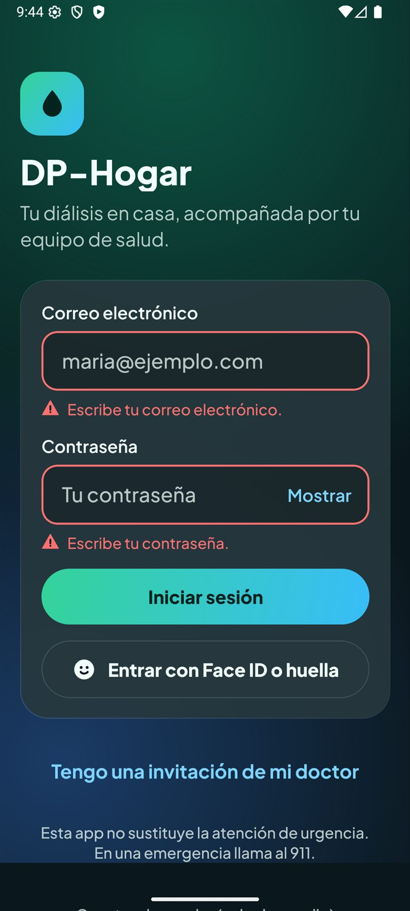 | 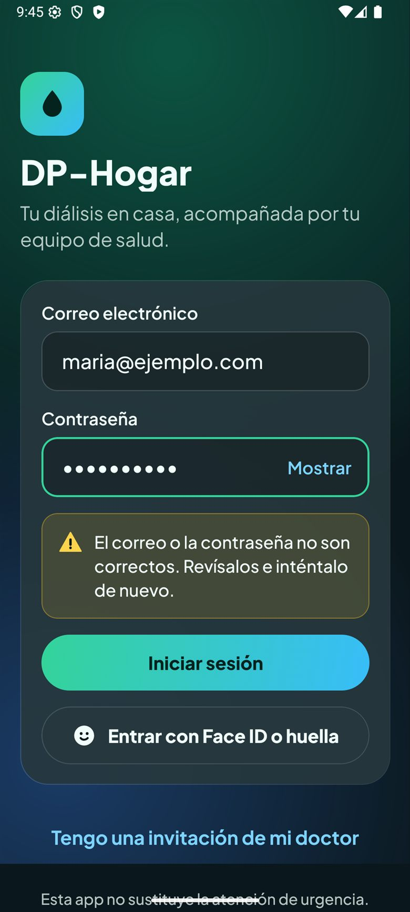 | 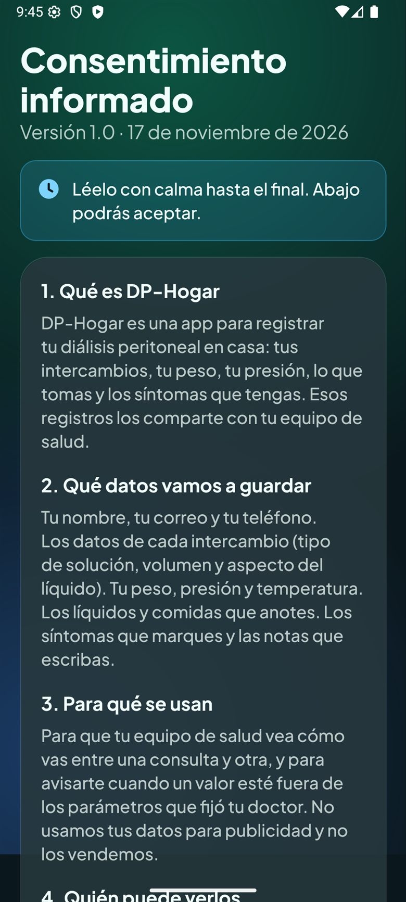 | 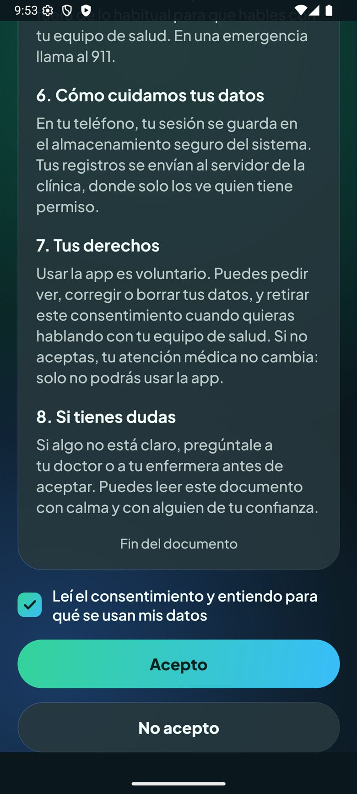 |

| Código inválido                                               | Código vencido                                              | Datos y contraseña                                      | Requisitos cumplidos                                              | Cuenta nueva                                                      |
| ------------------------------------------------------------- | ----------------------------------------------------------- | ------------------------------------------------------- | ----------------------------------------------------------------- | ----------------------------------------------------------------- |
| 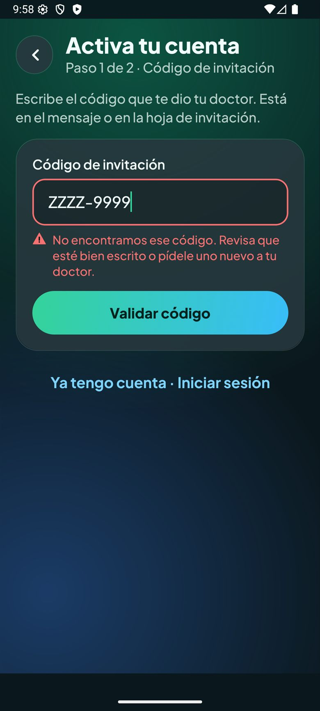 | 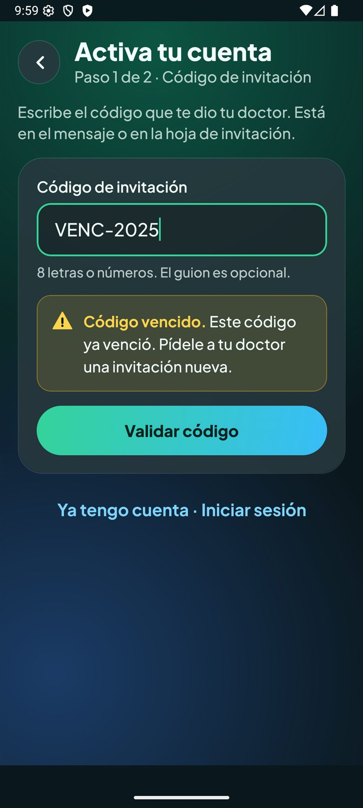 | 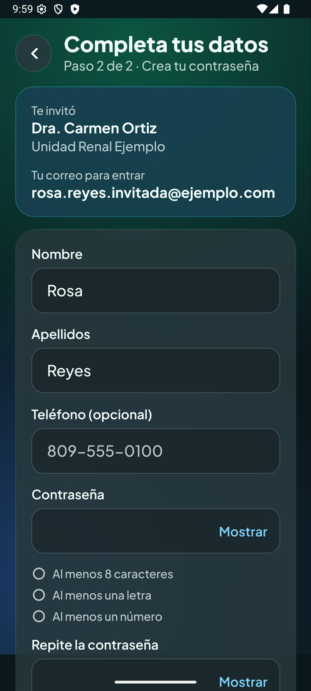 | 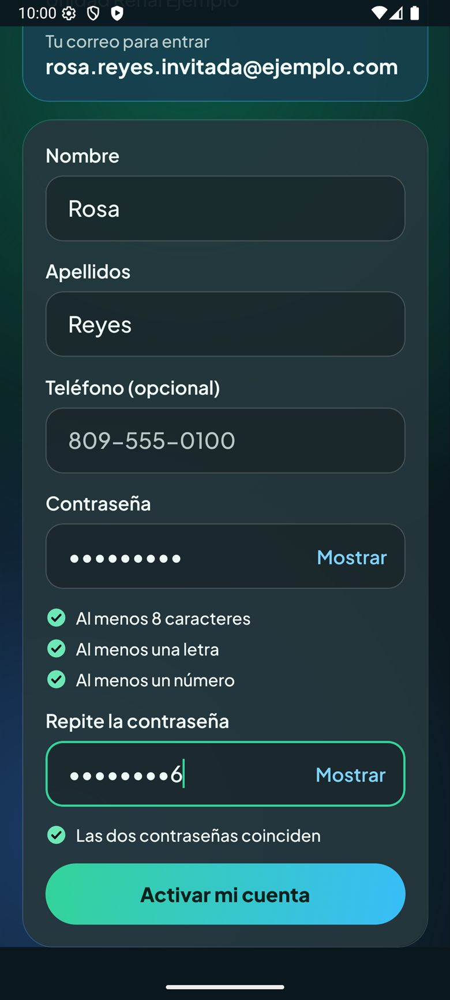 | 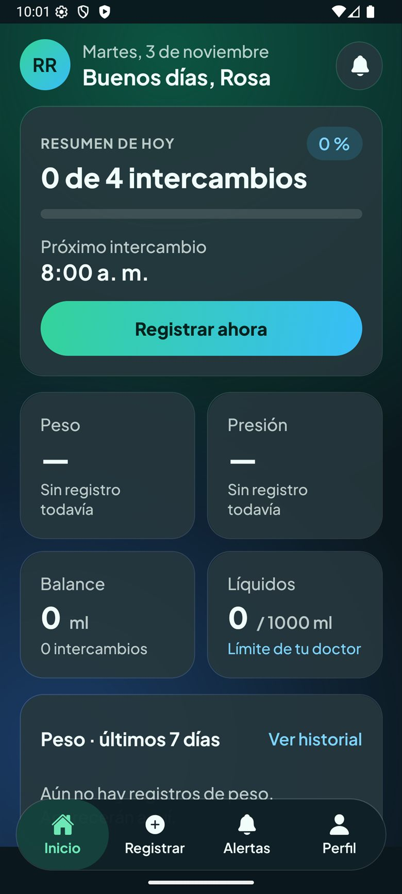 |

**MOV-RF-003 · Login.** Valida el formato del correo y que la contraseña no esté vacía antes de llamar al servicio. Los errores aparecen bajo cada campo, se anuncian al lector de pantalla y el foco va al primer campo con error. Con credenciales incorrectas el mensaje es siempre el mismo, así no revela si el correo existe. El token se guarda en **expo-secure-store** (Keychain / Keystore) y la sesión se mantiene al reabrir la app. **Cerrar sesión** está en Perfil.

**Face ID o huella.** Usa `expo-local-authentication`. Después de entrar una vez con contraseña, el teléfono recuerda la cuenta y el botón permite volver a entrar con biometría, también después de cerrar sesión. Si el teléfono no tiene huella ni Face ID configurados, la app lo explica. Pendiente con el backend: un refresh token propio y una opción en Ajustes para desactivarlo.

**MOV-RF-001 · Invitación.** "Tengo una invitación de mi doctor" → código (con o sin guion, en mayúsculas o minúsculas) → datos que precargó el doctor, teléfono opcional y contraseña con **requisitos visibles** (8 caracteres, una letra, un número) y **confirmación**. Al terminar, la cuenta queda activada con la sesión abierta y pasa al consentimiento. Errores cubiertos: formato inválido, código no encontrado, **vencido** y **ya usado**.

**MOV-RF-002 · Consentimiento.** El texto está versionado en `services/consent/consentDocument.ts` y es un **borrador** que debe aprobar el equipo de salud. La casilla se habilita **solo al llegar al final** del documento, y "Acepto" exige además marcarla. Se guarda `{ userId, version, acceptedAt (ISO, UTC), syncedAt: null }` **en el teléfono**, por usuario. Si sube la versión, se vuelve a pedir. Mientras no acepte, el navegador solo muestra esta pantalla. "No acepto" explica por qué no puede usar la app y cierra la sesión.

### Datos de prueba

| Qué                    | Valor                                                          |
| ---------------------- | -------------------------------------------------------------- |
| Paciente del prototipo | `maria@ejemplo.com` / `demo1234`                               |
| Otros pacientes        | **Cuentas de prueba**, al pie del login (todas con `demo1234`) |
| Invitación válida      | `DEMO-2026`                                                    |
| Invitación vencida     | `VENC-2025`                                                    |
| Invitación ya usada    | `USAD-2026`                                                    |
| Código inexistente     | Cualquier otro, por ejemplo `ZZZZ-9999`                        |

Al activar `DEMO-2026` el código queda usado. Para repetir la demo: **Cuentas de prueba → Reiniciar datos de demostración**. Borra las cuentas activadas, los códigos usados y los consentimientos de ese teléfono.

## Pacientes sintéticos (SIS-RF-019)

| Cuentas de prueba                                                 | Inicio de otro paciente                                 | Sus alertas                                               |
| ----------------------------------------------------------------- | ------------------------------------------------------- | --------------------------------------------------------- |
| 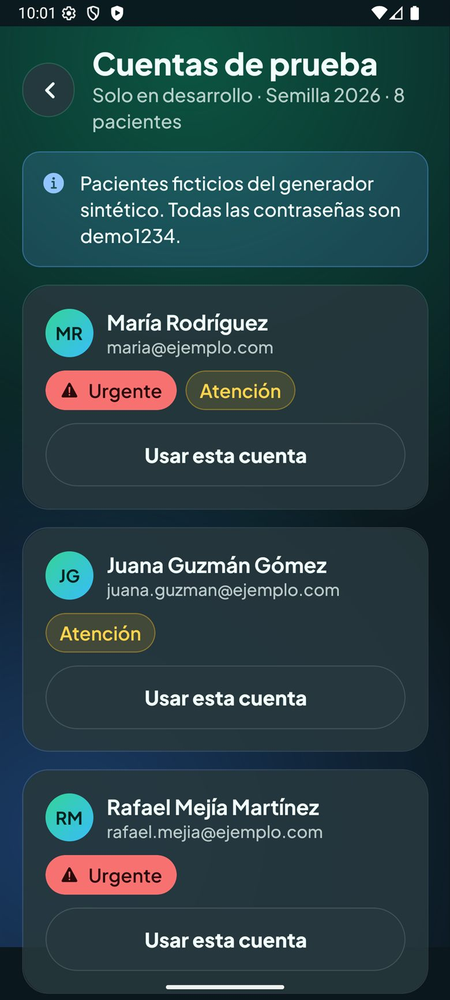 | 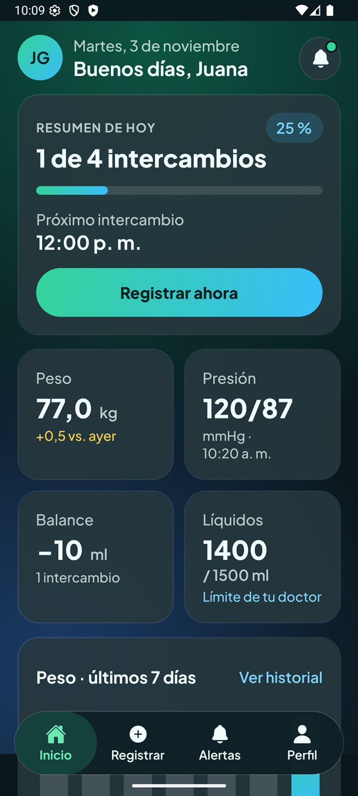 | 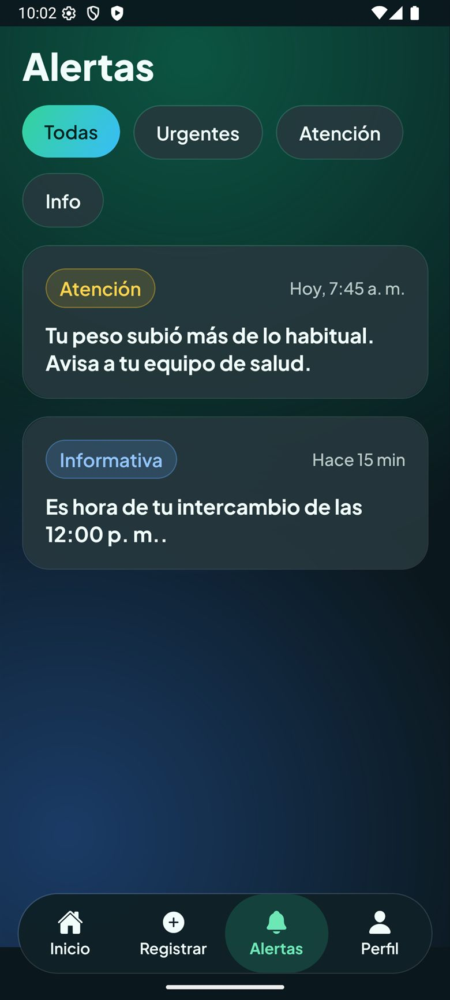 |

`src/dev/synthetic/` genera pacientes **ficticios**: nombre, correo `@ejemplo.com`, edad, peso seco y de la semana, presión, temperatura, intercambios y balance, líquidos y límite del doctor, pendientes y alertas. Los valores siguen los rangos del prototipo y tres escenarios: estable, atención y urgente. Las alertas salen de los mismos rangos de ejemplo de la app (`utils/ranges.ts`) y nunca diagnostican. El primer paciente siempre es María, con los datos exactos del prototipo.

- **Determinista:** la misma semilla da los mismos pacientes (PRNG mulberry32 propio). Si pides menos pacientes, obtienes el inicio de la misma lista.
- **En la app (modo mock):** en desarrollo, el backend simulado se llena con `EXPO_PUBLIC_SYNTHETIC_SEED` y `EXPO_PUBLIC_SYNTHETIC_COUNT` (por defecto 2026 y 8). Inicio, Registrar y Alertas muestran los datos del paciente con sesión.
- **Cuentas de prueba:** enlace al pie del login, solo con `__DEV__`. Toca una cuenta para llenar el login o un código para llenar la activación.
- **Como JSON**, para demos o para sembrar el backend:

    ```bash
    npm run synthetic -- --seed 42 --count 10 --date 2026-11-17 > pacientes.json
    npm run synthetic -- --no-demo   # sin María
    ```

    Corre con la eliminación de tipos de Node 22.18+ / 24, sin compilar ni dependencias. Por eso los archivos del generador importan con extensión `.ts`.

- **Nunca en producción:** la app lo carga con `require` dentro de `if (__DEV__)` (`services/mock/devSeed.ts`) y Metro elimina esa rama al empaquetar. Comprobado con `npx expo export --platform android`: los nombres del catálogo y los códigos `DEMO-2026`, `VENC-2025` y `USAD-2026` están en el bundle de desarrollo y **no** en el de producción. La pantalla "Cuentas de prueba" tampoco se registra fuera de `__DEV__`.

## Backend simulado y endpoints pendientes

El backend hoy solo expone `/api/health/`. Cada servicio tiene una **interfaz** (`services/*/types.ts`) con el contrato propuesto y una implementación **mock** (`services/mock/mockBackend.ts`, `services/consent/localConsentService.ts`). Para conectar el backend real hay que crear las implementaciones HTTP y elegirlas en `services/index.ts`.

| Servicio             | Contrato propuesto                                                                      | Hoy                                                               |
| -------------------- | --------------------------------------------------------------------------------------- | ----------------------------------------------------------------- |
| `AuthService`        | `POST /api/auth/login/` · `GET /api/auth/me/` · `POST /api/auth/logout/`                | Mock, con token opaco `mock.<id>.<t>`                             |
| `InvitationService`  | `POST /api/invitations/validate/` · `POST /api/invitations/activate/` (404 · 410 · 409) | Mock. Cuentas activadas y códigos usados persisten en SecureStore |
| `ConsentService`     | `GET /api/consents/current/` · `POST /api/consents/`                                    | Solo en el teléfono (`syncedAt: null`)                            |
| `PatientDataService` | Resumen del día (M7)                                                                    | Mock sincrónico con datos sintéticos                              |

## Accesibilidad

- Todo elemento interactivo tiene `accessibilityRole` y `accessibilityLabel`; los íconos decorativos están ocultos.
- La severidad nunca depende solo del color: el texto siempre es visible y la urgente lleva ícono y fondo sólido.
- Los avisos de campo fuera de rango se leen como pista del campo (`accessibilityHint`), el equivalente en React Native de `aria-describedby`.
- Los avisos nunca diagnostican: "Este valor está fuera de lo habitual. Avisa a tu equipo de salud."
- Se respeta la fuente grande del sistema. Desde 1.3× las grillas pasan a una columna. Probado en Android a 1.5×:

| Inicio (1.5×)                                                                  | Signos vitales (1.5×)                                                                          |
| ------------------------------------------------------------------------------ | ---------------------------------------------------------------------------------------------- |
| 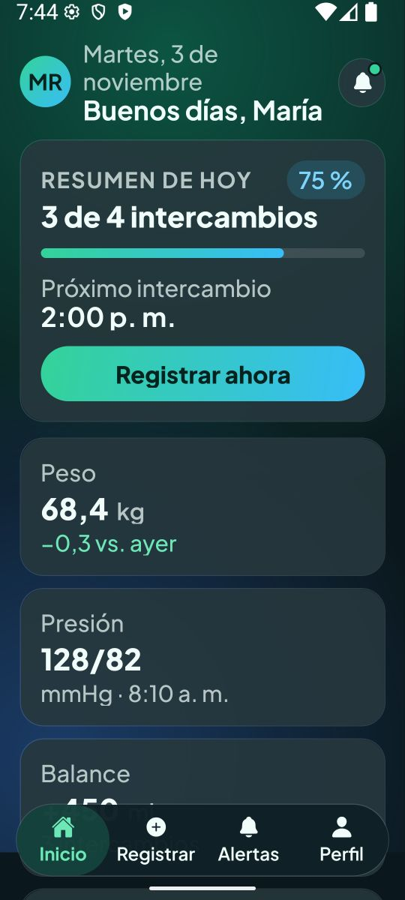 | 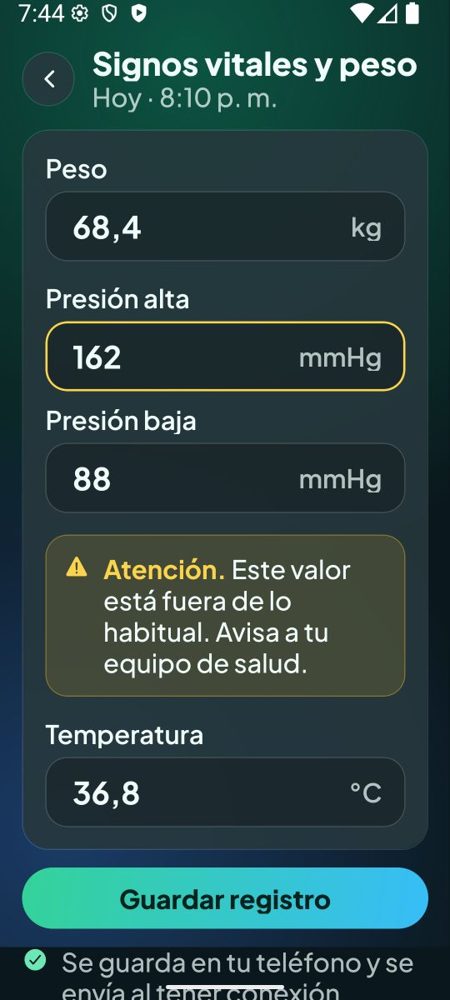 |

| Login (1.5×)                                                                 | Activación por invitación (1.5×)                                                       |
| ---------------------------------------------------------------------------- | -------------------------------------------------------------------------------------- |
| 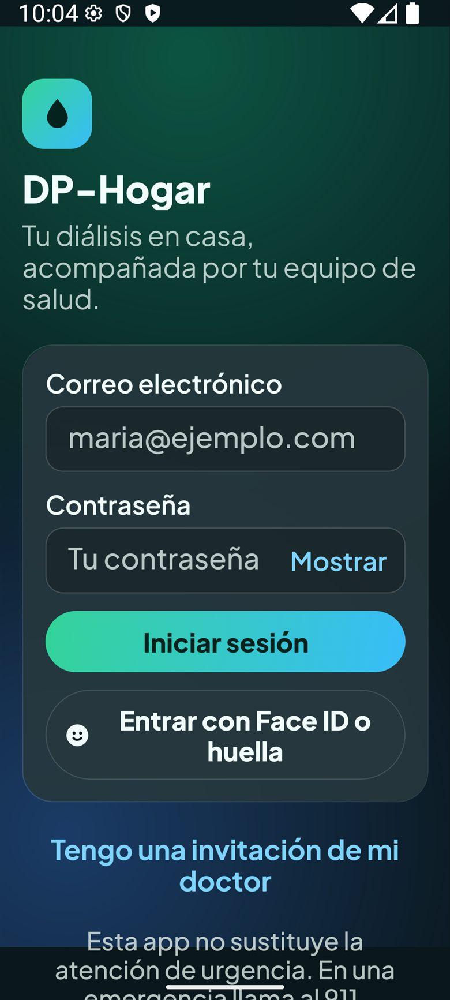 | 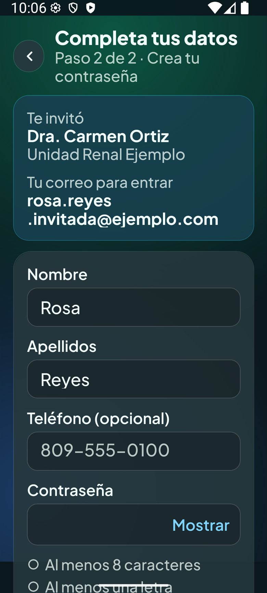 |

## Reglas

- Solo datos ficticios (`src/constants/`, `src/dev/synthetic/`). Nunca datos de pacientes reales.
- Instala dependencias con `npx expo install` para obtener versiones compatibles con el SDK.
- Los rangos de `utils/ranges.ts` son de **ejemplo** para la maqueta; los rangos reales los definirá el equipo de salud desde el backend.
