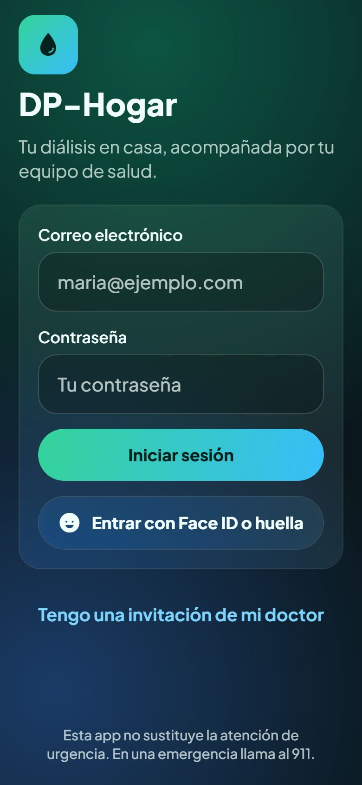
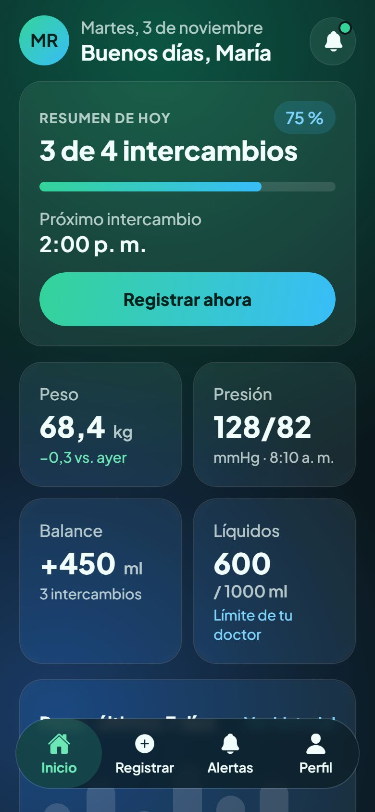
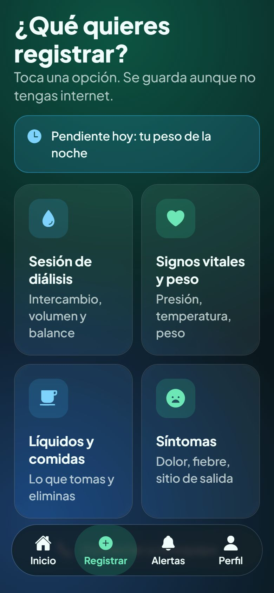
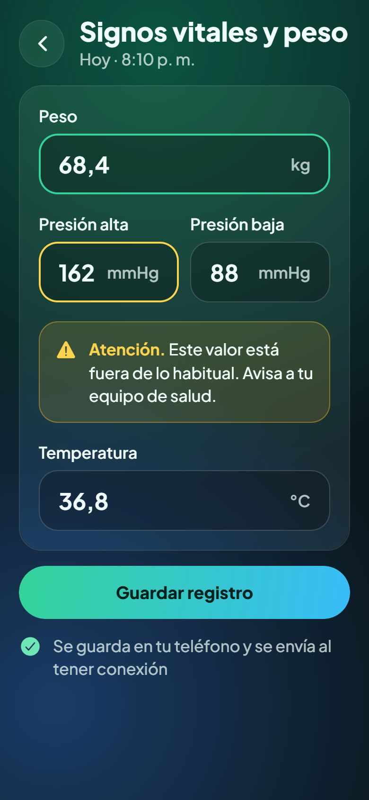
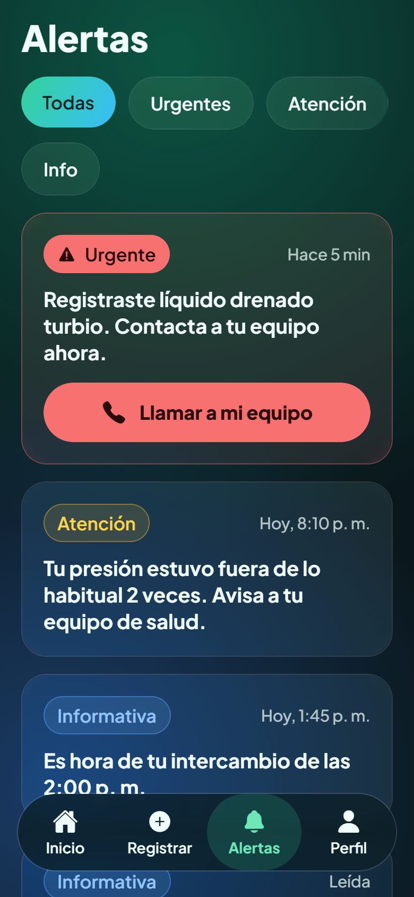
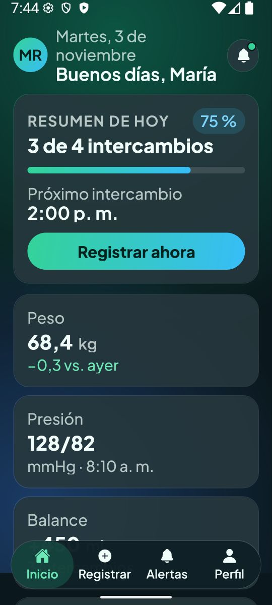
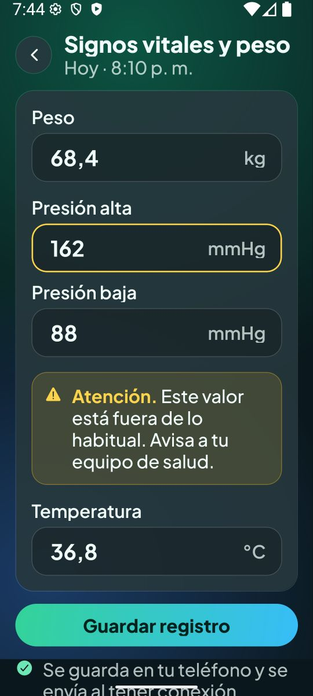

# DP-Hogar · App móvil

App para pacientes de diálisis peritoneal en casa y sus cuidadores (React Native + Expo, iOS y Android).

> **Estado (BASE-MOV):** proyecto base, navegación, sistema de diseño y pantallas maquetadas con **datos ficticios**. Todavía no hay lógica de módulos (M1–M12) ni conexión con el backend.

| Login                                  | Inicio                                   | Registrar                                      | Signos vitales                                           | Alertas                                    |
| -------------------------------------- | ---------------------------------------- | ---------------------------------------------- | -------------------------------------------------------- | ------------------------------------------ |
|  |  |  |  |  |

## Requisitos

- [Node.js](https://nodejs.org/) 20 o más reciente (probado con Node 24) y npm.
- Para probar en un teléfono: la app **Expo Go** (iOS o Android), versión para **SDK 58**.
- Para emuladores (opcional):
    - **Android:** Android Studio con un emulador (AVD).
    - **iOS:** una Mac con Xcode y el simulador de iOS.

No necesitas Python ni Docker para trabajar solo en la app móvil.

## Cómo correr la app

```bash
cd mobile
npm install
cp .env.example .env.local   # opcional: todavía no se usa
npm start                    # abre Expo; escanea el QR con Expo Go
```

| Plataforma         | Comando           | Notas                                                                    |
| ------------------ | ----------------- | ------------------------------------------------------------------------ |
| Android (emulador) | `npm run android` | Abre el emulador y lo instala en Expo Go.                                |
| iOS (simulador)    | `npm run ios`     | Solo en Mac.                                                             |
| Teléfono físico    | `npm start`       | Escanea el QR. El teléfono y la computadora deben estar en la misma red. |
| Navegador          | `npm run web`     | Útil para revisar el diseño rápido; la app está pensada para móvil.      |

Para entrar, toca **Iniciar sesión**: la sesión es simulada y acepta cualquier dato.

### Variables de entorno

| Variable              | Para qué                            | Valor de ejemplo                                                                    |
| --------------------- | ----------------------------------- | ----------------------------------------------------------------------------------- |
| `EXPO_PUBLIC_API_URL` | URL del backend (todavía no se usa) | `http://localhost:8000` (simulador iOS) · `http://10.0.2.2:8000` (emulador Android) |

`.env.local` es personal y no se sube a Git.

## Scripts

| Script                            | Qué hace                                                        |
| --------------------------------- | --------------------------------------------------------------- |
| `npm start`                       | Servidor de desarrollo de Expo                                  |
| `npm run android` / `ios` / `web` | Abre la app en esa plataforma                                   |
| `npm run typecheck`               | TypeScript estricto (`tsc --noEmit`)                            |
| `npm run lint`                    | ESLint (configuración de Expo + Prettier)                       |
| `npm run format` / `format:check` | Formatea / revisa el formato con Prettier                       |
| `npm test`                        | Pruebas con Jest y React Native Testing Library                 |
| `npm run doctor`                  | `expo-doctor`: revisa dependencias y configuración              |
| `npm run export`                  | Genera los bundles de producción (comprueba que la app compila) |

Antes de abrir un PR: `npm run typecheck && npm run lint && npm test && npm run doctor`.

## Estructura

```
mobile/
├── index.ts                 # punto de entrada (registra src/App)
├── app.json                 # configuración de Expo
├── src/
│   ├── App.tsx              # fuentes, proveedores y navegación
│   ├── navigation/          # RootNavigator, AuthStack, MainTabs, pilas y tipos de rutas
│   ├── screens/             # una carpeta por módulo (auth, home, register, alerts, profile, dev)
│   ├── components/ui/       # componentes base del sistema de diseño (+ __tests__)
│   ├── theme/               # tokens: colores, tipografía, espaciado, vidrio
│   ├── services/            # sesión simulada y configuración de la API
│   ├── constants/           # textos compartidos, módulos y datos ficticios
│   ├── types/               # tipos compartidos
│   └── utils/               # formato de números, rangos de ejemplo, contraste
└── docs/screenshots/        # capturas para el README y los PR
```

## Navegación

```
RootNavigator ── sin sesión ──> AuthStack: Login (M1) · Registro por invitación (M1, placeholder)
              └─ con sesión ──> MainTabs (barra flotante)
                                 ├─ Inicio (M7)
                                 ├─ Registrar ─ menú → Sesión de diálisis (M2) · Signos vitales y peso (M3)
                                 │                     · Líquidos y comidas (M4) · Síntomas (M6)
                                 ├─ Alertas (M8)
                                 └─ Perfil (M1/M12) → Contactos y emergencia (M9) · Ajustes (M12)
                                                    · Catálogo de componentes (solo __DEV__)
```

- Las rutas están tipadas en `src/navigation/types.ts`.
- La barra de pestañas se oculta dentro de los formularios (por ejemplo, Signos vitales).
- Las pantallas sin diseño muestran título, código del módulo y "En construcción".

## Sistema de diseño: "glass oscuro"

Fondo azul petróleo con brillos ambientales, tarjetas de vidrio translúcido y acento verde → azul. Está adaptado a personas mayores: la legibilidad va primero. Los tokens viven en `src/theme/`; **no escribas colores, tamaños ni fuentes a mano en las pantallas**.

### Colores (`theme/colors.ts`)

| Token                                   | Valor                                                               | Uso                                                               |
| --------------------------------------- | ------------------------------------------------------------------- | ----------------------------------------------------------------- |
| `bg`                                    | `#0A171C`                                                           | Fondo base                                                        |
| `glowPrimary` / `glowSecondary`         | `rgba(16,185,129,0.38)` / `rgba(59,130,246,0.34)`                   | Brillos radiales (verde arriba, azul abajo)                       |
| `glass` · `glassBorder` · `glassSubtle` | `rgba(255,255,255,0.08)` · `0.14` · `0.05`                          | Tarjetas de vidrio, bordes, tarjetas leídas                       |
| `tabBarBg`                              | `rgba(15,32,38,0.82)`                                               | Barra de pestañas                                                 |
| `inputBg` · `inputBorder`               | `rgba(0,0,0,0.25)` · `rgba(255,255,255,0.18)`                       | Campos de texto                                                   |
| `text` · `textMuted`                    | `#F0FDFA` · `rgba(240,253,250,0.72)`                                | Texto principal y secundario                                      |
| `accentGradient`                        | `#34D399 → #38BDF8` (135°)                                          | Botón primario, chip activo, progreso, avatar, logo, barra de hoy |
| `onAccent`                              | `#04231F`                                                           | Texto sobre el degradado                                          |
| `accentGreen` · `accentGreenSoft`       | `#6EE7B7` · `rgba(52,211,153,0.18)`                                 | Pestaña activa (`accentText` / `accentSoft`)                      |
| `accentBlue` · `accentBlueSoft`         | `#7DD3FC` · `rgba(56,189,248,0.16)`                                 | Enlaces, badges, pendientes, notas del doctor                     |
| `focusBorder`                           | `#34D399`                                                           | Borde de campo enfocado                                           |
| `success`                               | `#6EE7B7`                                                           | Cambios positivos, guardado sin conexión                          |
| `info`                                  | `#93C5FD` sobre `rgba(96,165,250,0.18)`                             | Severidad informativa                                             |
| `attention`                             | `#FCD34D` sobre `rgba(251,191,36,0.14)`, borde `0.40`               | Atención / valor fuera de rango                                   |
| `urgent` · `onUrgent`                   | `#F87171` · `#2A0A0A`, fondo `rgba(248,113,113,0.12)`, borde `0.45` | Urgente, botón de peligro                                         |
| `urgentTextSoft`                        | `#FECACA`                                                           | Texto del botón `dangerSoft`                                      |

Una prueba automática (`theme/contrast.test.ts`) comprueba que los pares texto/fondo cumplen **4.5:1**.

### Tipografía (`theme/typography.ts`)

Plus Jakarta Sans (400–800). Una familia por peso, porque Android ignora `fontWeight` con fuentes propias.

| Variante                    | Tamaño / alto de línea         | Peso      |
| --------------------------- | ------------------------------ | --------- |
| `display`                   | 34 / 40                        | 800       |
| `title`                     | 28 / 34                        | 800       |
| `heading`                   | 22 / 28                        | 700       |
| `stat` · `statUnit`         | 30 / 36 · 17 / 22              | 800 · 600 |
| `bodyLg` · `lead`           | 19 / 25 · 19 / 26              | 700 · 400 |
| `body` · `label`            | 17 / 24 · 17 / 22              | 500 · 600 |
| `button`                    | 18 / 24                        | 800       |
| `caption` · `overline`      | 15 / 20 · 14 / 18 (mayúsculas) | 500 · 700 |
| `inputText` · `inputNumber` | 20 / 26 · 24 / 30              | 500 · 700 |
| `tabLabel`                  | 14 / 18                        | 600       |

### Espaciado, radios y tamaños (`theme/layout.ts`)

- Espaciado: 4 · 8 · 12 · 16 · 20 · 24 · 32. Margen lateral de pantalla: 20.
- Radios: 12 · 16 · 20 · tarjeta 24 · píldora.
- Área táctil mínima 48; botón 56; campo 64; ícono 24 (30 dentro de cuadros de 56 en el menú).
- Barra flotante: 72 de alto, a 16 de los lados y 24 del fondo (más la zona segura).

### Vidrio (`theme/glass.ts`)

`GlassCard` usa `BlurView` de expo-blur (intensidad 24, tinte oscuro) en iOS y web. En **Android** usa por defecto un fondo sólido translúcido (`androidFallback`), porque el desenfoque real necesita un `BlurTargetView` y puede ir lento. Cambia `glass.androidMode` a `'blur'` para probarlo.

### Íconos

Ionicons **rellenos** (`@expo/vector-icons`): `home`, `add-circle`, `notifications`, `person`, `water`, `heart`, `cafe`, `sad`, `call`, `warning`, `checkmark-circle`, `time`. Siempre van con texto al lado y se ocultan al lector de pantalla; solo `IconButton` va sin texto, y exige `accessibilityLabel`.

### Componentes (`components/ui`)

`Screen`, `AmbientBackground`, `GlassCard`, `AppText`, `Button` (primary, secondary, danger, dangerSoft; con carga, deshabilitado e ícono), `IconButton`, `StatCard`, `ProgressBar`, `MenuTile`, `TextField`, `NumberField`, `InlineNotice` (info, attention, urgent, pending), `SeverityBadge`, `FilterChips`, `AlertCard`, `FloatingTabBar`, `EmptyState`, `LoadingView`, `ConfirmDialog`, `OfflineHint`, y los auxiliares `Avatar`, `AppLogo`, `ScreenHeader`, `ListItem`, `Grid` y `AccentGradient`.

En desarrollo, **Perfil → Catálogo de componentes** muestra todos los componentes con sus variantes.

## Accesibilidad

- Todo elemento interactivo tiene `accessibilityRole` y `accessibilityLabel`; los íconos decorativos están ocultos.
- La severidad nunca depende solo del color: el texto siempre es visible y la urgente lleva ícono y fondo sólido.
- Los avisos de campo fuera de rango se leen como pista del campo (`accessibilityHint`), el equivalente en React Native de `aria-describedby`.
- Los avisos nunca diagnostican: "Este valor está fuera de lo habitual. Avisa a tu equipo de salud."
- Se respeta la fuente grande del sistema. Desde 1.3× las grillas pasan a una columna. Probado en Android a 1.5×:

| Inicio (1.5×)                                                                  | Signos vitales (1.5×)                                                                          |
| ------------------------------------------------------------------------------ | ---------------------------------------------------------------------------------------------- |
|  |  |

## Reglas

- Solo datos ficticios (`src/constants/mockData.ts`). Nunca datos de pacientes reales.
- Instala dependencias con `npx expo install` para obtener versiones compatibles con el SDK.
- Los rangos de `utils/ranges.ts` son de **ejemplo** para la maqueta; los rangos reales los definirá el equipo de salud desde el backend.
